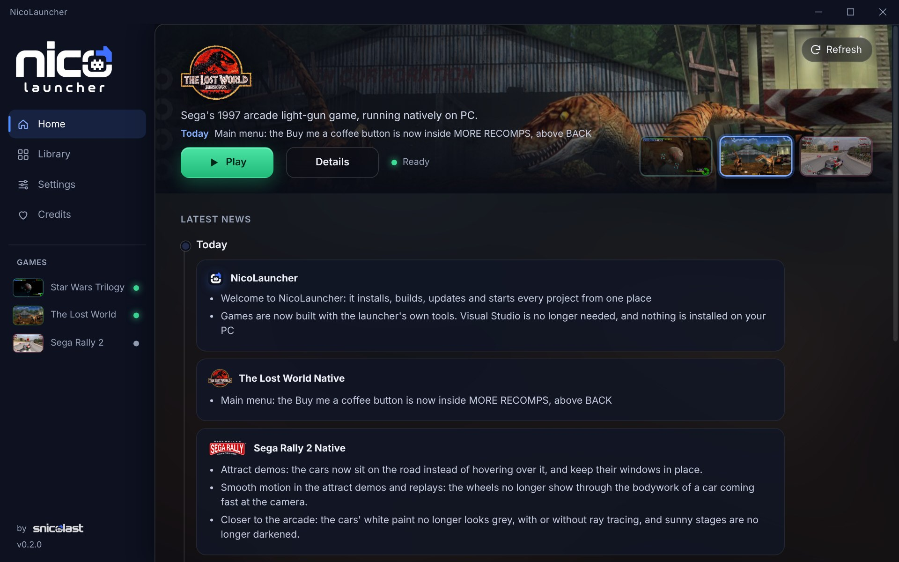
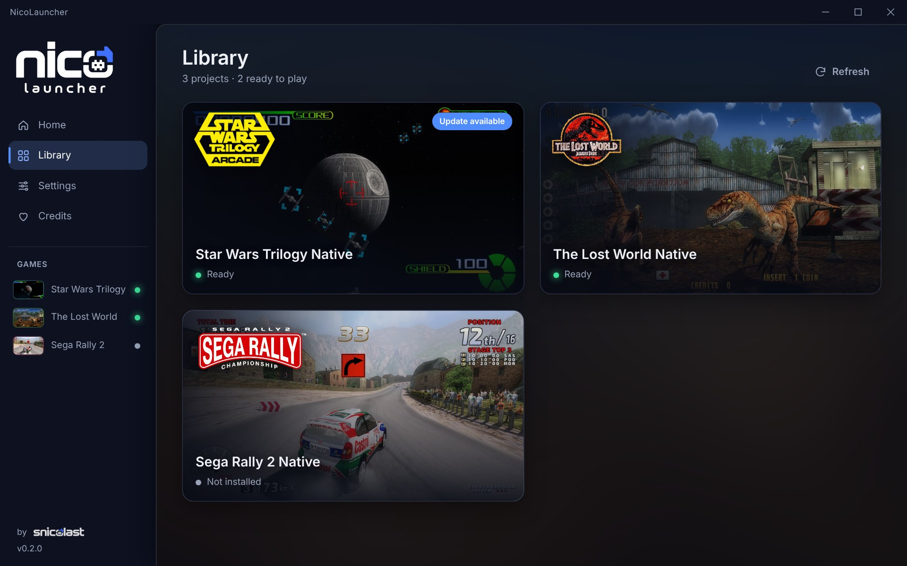
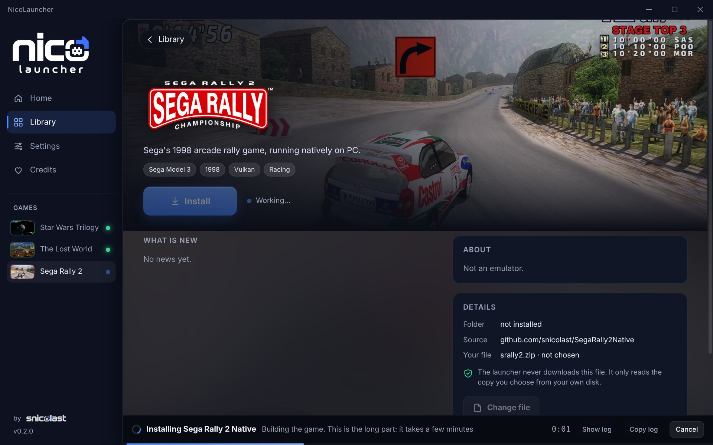
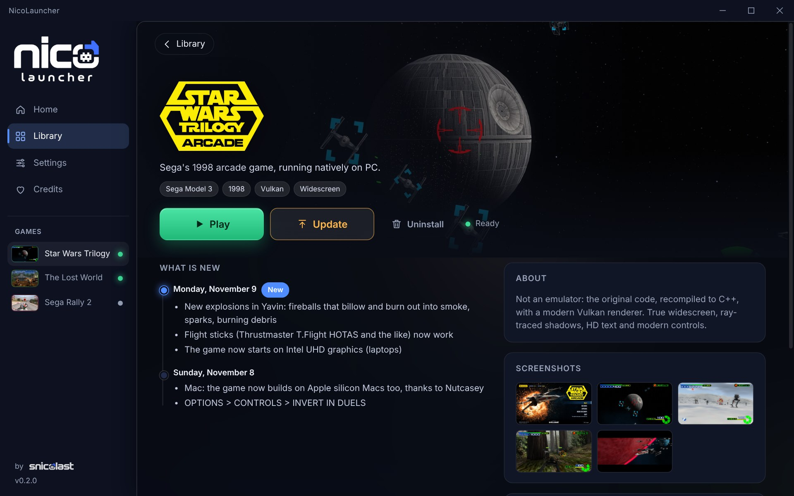

<p align="center">
  
</p>

<p align="center">
  One program to install, update and play <a href="https://github.com/snicolast">snicolast</a>'s native PC ports of arcade games.<br>
  You press <b>Install</b>, you wait, you press <b>Play</b>. That is all there is to it.
</p>

<p align="center">
  <a href="https://github.com/snicolast/NicoLauncher-Hub/releases/latest"><b>Download for Windows</b></a>
</p>



## The games

- [Star Wars Trilogy Native](https://github.com/snicolast/StarWarsTrilogyNative)
- [The Lost World Native](https://github.com/snicolast/LostWorldNative)
- [Sega Rally 2 Native](https://github.com/snicolast/SegaRally2Native)

New ones show up in the launcher by themselves.

## What you need

- A PC with Windows 10 or 11 (64-bit) and an internet connection.
- A few GB of free disk space.
- **Your own copy of each game's ROM file.** The launcher does not include it and cannot get it for you. Each game's page says which file it needs.

You do **not** need Visual Studio, Python or anything else. The launcher brings its own tools and keeps them in its own folder.

## Step by step

### 1. Download and install the launcher

Get **`NicoLauncher-setup.exe`** from the [latest release](https://github.com/snicolast/NicoLauncher-Hub/releases/latest) and run it.

Windows will probably show a blue box that says **"Windows protected your PC"**. That is normal: the installer is new and not code-signed yet. Click **More info**, then **Run anyway**.

### 2. Accept the license and choose a folder

The first time, the launcher shows its license. Scroll to the end and press **I accept**. Then choose the folder where your games will live, for example `D:\Games`. Any folder with free space will do.

### 3. Pick a game and press Install



Open the game you want and press **Install**.

### 4. Choose your ROM file

A file window opens. Find **your own** ROM file for that game and select it. It stays where you keep it: the launcher only reads it.

### 5. Wait



The launcher downloads the game's source code and builds the game on your PC. The bar at the bottom tells you what it is doing in plain words. It takes a few minutes, and the first game takes longer because the tools are downloaded too. You can keep using your PC meanwhile.

### 6. Play



When it says **Ready**, press **Play**. From then on, opening the launcher and pressing **Play** is all you do.

## Updates

- **Games:** when a game has something new, the launcher shows an **Update** button and what changed. One click.
- **The launcher:** it updates itself. A button appears at the bottom left when there is a new version.

## Questions

**Why do I have to build the game? Can't I just download it?**
No. The built game contains code that belongs to the original game, so it cannot be shared. What can be shared is the project's own source code, and the launcher turns that plus *your* ROM file into the game, on your PC. It does all the work for you.

**Where do I get the ROM file?**
From your own copy of the game. This project does not provide ROMs or say where to find them, so please do not ask.

**Is it an emulator?**
No. Each game is the original code translated to run directly on a PC, with a modern renderer.

**Something went wrong while installing.**
Press **Show log** in the bar at the bottom, then **Copy log**, and open an issue in that game's repository with the log pasted in. Most of the time, pressing **Install** again is enough, for example after an internet cut.

**How do I remove a game?**
Open the game and press **Uninstall**. It deletes the game's folder and nothing else. Your ROM file is not touched unless you put it inside that folder, and the launcher warns you if you did.

**Is it free?**
Yes, and it always will be. If you want to say thanks there is a coffee button in **Credits**, but it gets you nothing extra.

## What it does not do

- It does not include, download or link to game ROMs. You use your own copy.
- It does not download or share built games. Each one is built on your PC from its source code.
- These are unofficial fan projects, not affiliated with the owners of the original games, and they come with no obligation of support.

## Problems

Problems with a game go to that game's repository. Problems with the launcher go to [Issues](https://github.com/snicolast/NicoLauncher-Hub/issues) here.

## For developers

The launcher is open source: a Rust engine and a [Tauri 2](https://tauri.app) app with a plain HTML, CSS and JavaScript interface.

| Path | What |
| --- | --- |
| `crates/hub-core` | The engine, no interface: registry, source download, build kit, build steps, updates, news, settings |
| `src-tauri` | The app: the commands the interface calls, window, icons |
| `ui` | The interface. No build step |
| `registry.json` | The projects the launcher offers. Read from `main`, so adding one needs no release |
| `news.txt` | The launcher's own news |
| `kit.json` | The build tools the launcher downloads, each pinned by SHA-256 |
| `docs/manifest.md` | The `hub.toml` format a project uses to say how it is built |

To build it you need [Rust](https://rustup.rs) and Node.js, on Windows:

```
cargo test -p hub-core
npx @tauri-apps/cli@2 build --no-bundle
```

The exe is `target\release\nicolauncher.exe`. `npx @tauri-apps/cli@2 dev` runs it while you work on it. Releases are described in [docs/releasing.md](docs/releasing.md).

## License

MIT with additional terms: see [LICENSE](LICENSE). In short: keep the credit to snicolast, do not sell it, and do not change it to share built games or ROM data.
